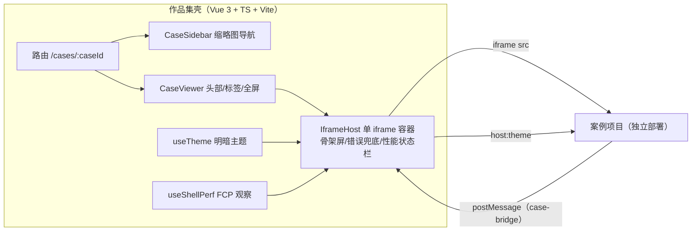

# Web 渲染案例作品集

求职用的 Web 渲染案例集中展示壳：左侧缩略图导航 + 右侧 iframe 运行区，统一呈现独立部署的前端渲染项目。案例通过配置注册（[src/config/cases.ts](src/config/cases.ts)），增删案例只改配置、不改壳代码。

**本仓库只做展示壳**：案例是各自独立维护的项目，通过 iframe 接入；壳不包含任何案例业务代码。

## 架构



- 路由：`/cases/:caseId` history 模式，深链接/刷新/前进后退可用（部署侧 404.html 兜底）。
- 单 iframe 复用：任意时刻 DOM 中至多一个案例 iframe，切换时先 `about:blank` 再销毁。
- 通信：postMessage 协议（`src/types/case-protocol.ts` 权威定义），三重校验 source / origin 白名单 / caseId。
- 主题：CSS 变量 + `data-theme`，壳与案例 iframe 通过 `host:theme` 同步。

## iframe 技术选型取舍

**为什么用 iframe**

| 收益         | 说明                                                                   |
| ------------ | ---------------------------------------------------------------------- |
| 真实运行环境 | 案例以真实构建产物运行（WebGL / PixiJS / Canvas 不受壳样式、脚本污染） |
| 隔离         | 独立浏览上下文，各案例技术栈、依赖、全局变量互不干扰                   |
| 部署灵活     | 案例可独立部署在任意地址，壳只持有 URL 配置                            |

**代价与对策**

| 代价                                                                    | 对策                                                                                                                      |
| ----------------------------------------------------------------------- | ------------------------------------------------------------------------------------------------------------------------- |
| postMessage 异步边界，无法直接操作案例 DOM                              | case-bridge 协议上报高度/全屏/主题/指标；未接入的案例降级为 iframe `load` 事件作就绪信号                                  |
| 跨域限制：案例若返回 `X-Frame-Options`/CSP `frame-ancestors` 会阻止嵌入 | onerror + 8 秒超时 + 重试 + "在新窗口打开"兜底                                                                            |
| 内存与初始化成本                                                        | 单 iframe 复用；销毁先 `about:blank` 留 300ms 宽限期（案例执行 pagehide 清理）再移除；只预取下一案例文档，不预创建 iframe |
| 嵌套滚动                                                                | 案例通过 `case:height` 上报高度，壳按"上报高度与视口可用高度的较小值"自适应，页面级滚动接管                               |
| 缩略图不能取 iframe 内容                                                | 静态缩略图 + IntersectionObserver 懒加载                                                                                  |

## 目录结构

```
├── case-bridge.js / case-bridge.d.ts  # 案例接入脚本（复制进案例项目，零依赖）
├── public/thumbnails/                 # 缩略图（推荐 640×400 WebP，当前为占位 SVG）
├── docs/case-readme-template.md       # 案例项目独立 README 模板
├── src/
│   ├── components/        # CaseSidebar / CaseViewer / IframeHost / ErrorFallback / ...
│   ├── composables/       # useIframeCase（生命周期/通信）/ useTheme / useShellPerf
│   ├── config/cases.ts    # 案例元数据（URL/缩略图/指标占位），接入入口
│   ├── router/            # createAppRouter 工厂（history 可注入，便于测试）
│   ├── types/             # postMessage 协议类型与运行时守卫
│   ├── views/ styles/     # 页面与 CSS 变量主题
└── .github/workflows/     # ci.yml（静态验证）+ deploy.yml（GH Pages 部署）
```

## 运行方式

```bash
pnpm install
pnpm dev                 # http://localhost:5173（dev 下 base 为 '/'）
pnpm typecheck           # vue-tsc + tsc
pnpm lint                # ESLint
pnpm test                # Vitest 单元测试
pnpm build               # typecheck + vite build（base 见下）
pnpm preview             # 预览构建产物（挂在 base 子路径，如 /frontend-casebook/）
```

**base 策略**：构建默认 `base = /frontend-casebook/`（GH Pages 子路径），可用环境变量 `APP_BASE` 覆盖（如 `APP_BASE=/ pnpm build`）；本地 dev 固定 `/`。vite base 与路由 base 统一由 `import.meta.env.BASE_URL` 驱动，无需两处配置。

## 案例接入

### 1. 注册元数据

编辑 [src/config/cases.ts](src/config/cases.ts)：

| 字段                         | 说明                                              |
| ---------------------------- | ------------------------------------------------- |
| `id`                         | 唯一标识，即路由 `/cases/:caseId` 的 caseId       |
| `title` / `summary` / `tech` | 展示文案与标签                                    |
| `thumbnail`                  | 缩略图路径（`public/` 下，推荐 640×400 WebP）     |
| `url`                        | 开发环境地址（本地案例 dev server）               |
| `productionUrl`              | 生产环境地址；为空时回退 `url`                    |
| `protocol`                   | 是否接入 case-bridge 协议（见下）                 |
| `metrics`                    | 性能指标占位：`value: '待测'` + `method` 测量方法 |

### 2. 缩略图（真实截图替换占位图）

当前 `public/thumbnails/` 是自绘占位 SVG。替换为真实截图（推荐 640×400 WebP，体积小）：

```bash
# 方式一：Chrome DevTools 截屏后裁切到 640×400，导出 WebP
# 方式二：Playwright 截图（无需安装依赖，npx 即用）
npx playwright screenshot --viewport-size="1280,800" http://localhost:5173 public/thumbnails/<caseId>.webp
```

生成后同步修改 `config/cases.ts` 中对应案例的 `thumbnail` 路径。**禁止用 iframe 渲染缩略图**。

### 3. 接入 case-bridge（可选，强烈建议）

1. 复制仓库根目录 `case-bridge.js`（TS 项目可连 `case-bridge.d.ts` 一起）到案例项目，入口引入即可自动初始化；
2. 或显式调用 `window.CaseBridge.createCaseBridge({ caseId, reportHeight: true })`；
3. 在壳的 `config/cases.ts` 把该案例 `protocol` 置为 `true`（`true` 时以 `case:ready` 为就绪信号，`false` 时降级为 iframe `load` 事件）。

**消息协议**（壳侧运行时校验 origin/source/caseId）：

| 方向      | type              | 关键字段                              | 说明                              |
| --------- | ----------------- | ------------------------------------- | --------------------------------- |
| 案例 → 壳 | `case:ready`      | `protocolVersion`, `metrics?`         | 就绪信号                          |
| 案例 → 壳 | `case:error`      | `message`, `fatal`                    | 错误上报；fatal 进错误态          |
| 案例 → 壳 | `case:height`     | `height`                              | 内容高度 → 壳自适应（防滚动嵌套） |
| 案例 → 壳 | `case:fullscreen` | —                                     | 请求全屏（需用户手势）            |
| 案例 → 壳 | `case:metrics`    | `metrics`（fps/drawCalls/loadTimeMs） | 运行时指标，显示在壳状态栏        |
| 壳 → 案例 | `host:theme`      | `theme`                               | 明暗主题同步                      |

**origin 校验策略**：生产环境严格校验 `location.origin`（同源）；开发环境白名单 = 壳自身 + 案例 `url` 的 origin + 可选 `VITE_CASE_DEV_ORIGINS`（逗号分隔）。协议版本当前为 `'1'`。

### 4. 案例项目独立 README

每个案例项目按 [docs/case-readme-template.md](docs/case-readme-template.md) 模板补齐运行方式、技术要点与性能指标。

## 性能指标

原则：**不伪造数据**。未实测的指标一律 `待测` 并附测量方法。

- 壳已实测记录（运行时显示在 iframe 下方状态栏）：iframe 加载耗时、案例切换耗时、壳首屏 FCP（PerformanceObserver）。
- 案例指标占位：`config/cases.ts` 每案例 `metrics` 数组（如帧率/显存/draw calls）；接入 bridge 后案例可实时上报 `fps` / `drawCalls` / `loadTimeMs` 显示在状态栏。

## 部署（GitHub Pages）

1. 将仓库推送到 GitHub（假定仓库名 `frontend-casebook`，与默认 base 一致）。
2. 仓库 Settings → Pages → Build and deployment → Source 选 **GitHub Actions**。
3. 之后每次 push 到工作流配置的分支（`.github/workflows/deploy.yml`）自动构建部署，站点地址 `https://<用户名>.github.io/frontend-casebook/`。
4. 案例生产地址填入 `config/cases.ts` 的 `productionUrl`。

**深链接**：workflow 会把构建产物复制为 `404.html`，未知路径（如 `/frontend-casebook/cases/<caseId>`）由 GitHub 提供该文件，应用启动后路由正常解析——刷新/直达不 404。

**仓库改名时**：同步修改 [vite.config.ts](vite.config.ts) 默认 base 与 `.github/workflows/deploy.yml` 的 `APP_BASE`（两者保持一致）。

## 验收标准核对清单

| #   | 标准                                                                        | 现状                                                                                                                          |
| --- | --------------------------------------------------------------------------- | ----------------------------------------------------------------------------------------------------------------------------- |
| 1   | `pnpm install && pnpm dev` 可启动；`pnpm build` 通过；类型检查、ESLint 通过 | 静态验证全绿（typecheck/lint/test/build）；`dev` 启动由用户手动验收                                                           |
| 2   | 左侧缩略图懒加载正常；切换案例时旧 iframe 销毁、无内存泄漏                  | IntersectionObserver 懒加载（无 IO 环境回退立即加载）；单 iframe + about:blank → 300ms 宽限 → remove；单测覆盖销毁时序        |
| 3   | postMessage 校验 origin；错误和超时兜底；新窗口打开可用                     | source/origin/caseId 三重校验 + 类型守卫；8 秒超时、onerror、重试、"在新窗口打开"（错误态与常驻入口均有）                     |
| 4   | 移动端布局正常；iframe 可全屏                                               | <860px 缩略图折叠为顶部横向滚动、页面级滚动；壳全屏按钮 + 案例 `case:fullscreen` 请求                                         |
| 5   | 每个案例有独立 README 和性能指标占位；作品集 README 写清 iframe 取舍        | 案例为独立项目，README 由各项目按 `docs/case-readme-template.md` 维护；指标占位在 `config/cases.ts`；本文档含 iframe 取舍说明 |
| 6   | 不出现版权素材、真实密钥、公司敏感信息                                      | 占位缩略图为自绘 SVG；无密钥/真实数据；详见版权说明                                                                           |

## AI 工具使用记录

- **工具**：Qoder 桌面端 AI 编程助手（Claude 模型）。
- **用途**：脚手架与配置文件生成、组件/组合式函数实现、单元测试编写、静态验证与缺陷修复。
- **Prompt 示例**：「创建一个 Vue3 + TS + Vite 的作品集展示壳：左缩略图栏、右单 iframe 运行区、/cases/:caseId 历史路由、postMessage 协议校验 origin…按阶段执行，每阶段输出改动清单与验收步骤。」
- **采纳**：绝大部分实现代码，均经过每阶段 `typecheck/lint/test/build` 静态验证后采纳。
- **人工重写/调整**：整体架构与阶段划分由用户主导；postMessage 安全校验链、origin 白名单策略、iframe 销毁时序（宽限期）、GH Pages base/404 兜底方案经人工审查调整。
- **发现的问题**：typescript 7 与 typescript-eslint 8.72 的 peer 冲突（降级 TS 5.9）；vue-router v5 无 GlobalComponents 声明（组件内显式导入）；jsdom 不支持 IntersectionObserver/iframe 异步 load 的测试差异（mock 处理）。
- **风险控制**：小阶段提交可回滚；协议类型单一来源 + 运行时守卫；未实测指标一律"待测"；不提交密钥与真实数据。

## 版权说明

- 壳代码为本仓库原创，仅用于个人求职展示。
- `public/thumbnails/` 当前为自绘占位 SVG，无第三方素材；替换真实截图时请使用自己项目的画面。
- 案例内容与素材归各自案例项目所有，壳不内置任何案例素材。
- 依赖均为开源 npm 包，遵循各自许可证；无真实密钥、用户数据或公司敏感信息。
